<!-- ================================================================= -->
<!-- HERO BANNER: CYBERSPACE DEVELOPER WORKSPACE                      -->
<!-- ================================================================= -->

  

 

<!-- ================================================================= -->
<!-- HERO SECTION: DYNAMIC TYPING + 3D DEVELOPER VISUAL               -->
<!-- ================================================================= -->

<table align="center" width="100%" style="border-collapse: collapse; border: none;">
  <tr>
    <td width="64%" valign="middle" style="border: none; padding-right: 20px;">
      <h2 style="margin: 0 0 6px 0; font-size: 28px; font-weight: 800; color: #FFFFFF; font-family: -apple-system, BlinkMacSystemFont, 'Segoe UI', Roboto, sans-serif;">
        ⚡ Hello World, I'm Gopal Maddheshiya
      </h2>
      

        
      

      

        Computer Science &amp; Engineering undergraduate at <b>Shri Ramswaroop Memorial University (SRMU)</b>. I design and build high-performance web systems, native desktop software, and algorithmically sound architectures. Passionate about low-latency APIs, clean abstractions, and shipping dependable production code.
      

      

        
        &nbsp;
        
        &nbsp;
        
        &nbsp;
        
        &nbsp;
        
      

    </td>
    <td width="36%" valign="middle" align="center" style="border: none;">
      
    </td>
  </tr>
</table>

  

<!-- ================================================================= -->
<!-- SECTION B: DEVELOPER IDENTITY & CORE PILLARS                     -->
<!-- ================================================================= -->

### 🚀 Developer Overview &amp; Engineering Focus

<table width="100%" style="border-collapse: separate; border-spacing: 12px; border: none;">
  <tr>
    <td width="33%" valign="top" style="background-color: #0d1117; border: 1px solid #1e293b; border-radius: 10px; padding: 16px;">
      <h4 style="margin: 0 0 8px 0; color: #38bdf8; font-size: 15px;">💻 Desktop &amp; Web Systems</h4>
      

        Engineering native desktop client applications with <b>Electron &amp; Node.js</b> (Avap Browser) alongside responsive full-stack applications with <b>React &amp; TypeScript</b>.
      

    </td>
    <td width="33%" valign="top" style="background-color: #0d1117; border: 1px solid #1e293b; border-radius: 10px; padding: 16px;">
      <h4 style="margin: 0 0 8px 0; color: #a855f7; font-size: 15px;">🌾 National Hackathons</h4>
      

        Project Lead for <b>Krishi Suraksha</b> in Smart India Hackathon (SIH 2026), architecting AI-powered crop diagnostics and rural advisory systems.
      

    </td>
    <td width="33%" valign="top" style="background-color: #0d1117; border: 1px solid #1e293b; border-radius: 10px; padding: 16px;">
      <h4 style="margin: 0 0 8px 0; color: #f59e0b; font-size: 15px;">🧠 Data Structures &amp; DSA</h4>
      

        Rigorous daily practice in <b>Java</b> on LeetCode with strong algorithmic intuition for Trees, Graphs, Dynamic Programming, and asymptotic efficiency.
      

    </td>
  </tr>
</table>

  

<!-- ================================================================= -->
<!-- SECTION C: CURRENTLY BUILDING / FEATURED PROJECTS                -->
<!-- ================================================================= -->

### 🛠️ Featured Engineering Work

<table width="100%" style="border-collapse: separate; border-spacing: 12px; border: none;">
  <tr>
    <td width="50%" valign="top" style="background-color: #0d1117; border: 1px solid #30363d; border-radius: 10px; padding: 18px;">
      

        ● NATIVE DESKTOP SYSTEM
      

      <h3 style="margin: 0 0 8px 0; color: #58a6ff; font-size: 17px;">
        🌐 Avap Browser
      </h3>
      

        Modern, privacy-conscious desktop web browser engineered with Electron and Node.js. Implements multi-tab session isolation, custom native window chrome, bookmarking engine, and minimal memory footprint.
      

      

        
        
        
      

      

        
        &nbsp;
        
      

    </td>
    <td width="50%" valign="top" style="background-color: #0d1117; border: 1px solid #30363d; border-radius: 10px; padding: 18px;">
      

        ● SMART INDIA HACKATHON 2026
      

      <h3 style="margin: 0 0 8px 0; color: #58a6ff; font-size: 17px;">
        🌾 Krishi Suraksha
      </h3>
      

        National-level Smart India Hackathon (SIH 2026) innovation. AI-driven agricultural platform providing automated crop disease diagnostics, actionable spray advisory telemetry, and multilingual farmer portals.
      

      

        
        
        
      

      

        
        &nbsp;
        
      

    </td>
  </tr>
  <tr>
    <td width="50%" valign="top" style="background-color: #0d1117; border: 1px solid #30363d; border-radius: 10px; padding: 18px;">
      

        ● FULL-STACK REVISION TELEMETRY
      

      <h3 style="margin: 0 0 8px 0; color: #58a6ff; font-size: 17px;">
        🎯 DSA &amp; Interview Prep Tracker
      </h3>
      

        End-to-end algorithmic prep and revision tracker. Enables engineers to catalog multi-approach solutions, measure confidence telemetry, and trigger automated spaced-repetition revision cycles.
      

      

        
        
        
        
      

      

        
        &nbsp;
        
      

    </td>
    <td width="50%" valign="top" style="background-color: #0d1117; border: 1px solid #30363d; border-radius: 10px; padding: 18px;">
      

        ● E-COMMERCE COMMERCE PLATFORM
      

      <h3 style="margin: 0 0 8px 0; color: #58a6ff; font-size: 17px;">
        🛒 Arun Gopal Traders
      </h3>
      

        Production bilingual grocery and consumer retail platform featuring real-time cart computation, dynamic search and catalog filtering, responsive UI, and persistent MongoDB database storage.
      

      

        
        
        
        
      

      

        
        &nbsp;
        
      

    </td>
  </tr>
</table>

  

<!-- ================================================================= -->
<!-- SECTION D: TECHNICAL ARSENAL (HIGH-RES CATEGORIZED ICONS)       -->
<!-- ================================================================= -->

### 🛠️ Technical Arsenal &amp; Capabilities

<table width="100%" style="border-collapse: collapse; border: 1px solid #30363d;">
  <thead>
    <tr style="background-color: #161b22; border-bottom: 1px solid #30363d;">
      <th align="left" style="padding: 12px 16px; color: #58a6ff; font-size: 14px; width: 24%;">Domain</th>
      <th align="left" style="padding: 12px 16px; color: #58a6ff; font-size: 14px; width: 44%;">Technologies</th>
      <th align="left" style="padding: 12px 16px; color: #58a6ff; font-size: 14px; width: 32%;">Core Engineering Focus</th>
    </tr>
  </thead>
  <tbody>
    <tr style="background-color: #0d1117; border-bottom: 1px solid #21262d;">
      <td style="padding: 12px 16px; font-weight: 600; color: #f0f6fc;"><b>🚀 Languages</b></td>
      <td style="padding: 12px 16px;">
        
      </td>
      <td style="padding: 12px 16px; color: #8b949e; font-size: 13px;">Object-oriented architecture, type safety, algorithmic problem-solving</td>
    </tr>
    <tr style="background-color: #0d1117; border-bottom: 1px solid #21262d;">
      <td style="padding: 12px 16px; font-weight: 600; color: #f0f6fc;"><b>⚛️ Frontend</b></td>
      <td style="padding: 12px 16px;">
        
      </td>
      <td style="padding: 12px 16px; color: #8b949e; font-size: 13px;">Component architecture, responsive UX, global state, fast builds</td>
    </tr>
    <tr style="background-color: #0d1117; border-bottom: 1px solid #21262d;">
      <td style="padding: 12px 16px; font-weight: 600; color: #f0f6fc;"><b>🛠️ Backend</b></td>
      <td style="padding: 12px 16px;">
        
      </td>
      <td style="padding: 12px 16px; color: #8b949e; font-size: 13px;">Asynchronous event loops, RESTful API routing, middleware security</td>
    </tr>
    <tr style="background-color: #0d1117; border-bottom: 1px solid #21262d;">
      <td style="padding: 12px 16px; font-weight: 600; color: #f0f6fc;"><b>🗄️ Databases</b></td>
      <td style="padding: 12px 16px;">
        
      </td>
      <td style="padding: 12px 16px; color: #8b949e; font-size: 13px;">Document stores, relational schema design, query optimization</td>
    </tr>
    <tr style="background-color: #0d1117;">
      <td style="padding: 12px 16px; font-weight: 600; color: #f0f6fc;"><b>⚡ Desktop &amp; Tools</b></td>
      <td style="padding: 12px 16px;">
        
      </td>
      <td style="padding: 12px 16px; color: #8b949e; font-size: 13px;">Native desktop clients (Electron), Git workflow, production builds</td>
    </tr>
  </tbody>
</table>

  

<!-- ================================================================= -->
<!-- SECTION E: TELEMETRY & GITHUB ACTIVITY                           -->
<!-- ================================================================= -->

### 📊 Activity &amp; Development Telemetry

<table width="100%" style="border-collapse: collapse; border: none;">
  <tr>
    <td width="50%" align="center" valign="middle" style="border: none; padding: 8px;">
      
    </td>
    <td width="50%" align="center" valign="middle" style="border: none; padding: 8px;">
      
    </td>
  </tr>
  <tr>
    <td width="50%" align="center" valign="middle" style="border: none; padding: 8px;">
      
    </td>
    <td width="50%" align="center" valign="middle" style="border: none; padding: 8px;">
      
    </td>
  </tr>
</table>

 

  <picture>
    <source media="(prefers-color-scheme: dark)" srcset="https://raw.githubusercontent.com/gopal-maddheshiya/gopal-maddheshiya/output/github-contribution-grid-snake-dark.svg">
    <source media="(prefers-color-scheme: light)" srcset="https://raw.githubusercontent.com/gopal-maddheshiya/gopal-maddheshiya/output/github-contribution-grid-snake.svg">
    
  </picture>

  

<!-- ================================================================= -->
<!-- SECTION F: LET'S CONNECT                                         -->
<!-- ================================================================= -->

<h3 style="color: #ffffff; font-size: 22px; margin-bottom: 8px;">🚀 Let's Connect &amp; Collaborate</h3>

  Actively seeking <b>Software Engineering Internships</b> &amp; technical collaborations. 
  Open to discussing systems architecture, desktop engineering, or algorithmic problems!

  
  &nbsp;
  
  &nbsp;
  
  &nbsp;
  
  &nbsp;
  

  <code>gopal@workstation:~$</code> echo "Dream it. Build it. Ship it." &amp;&amp; exit 0

